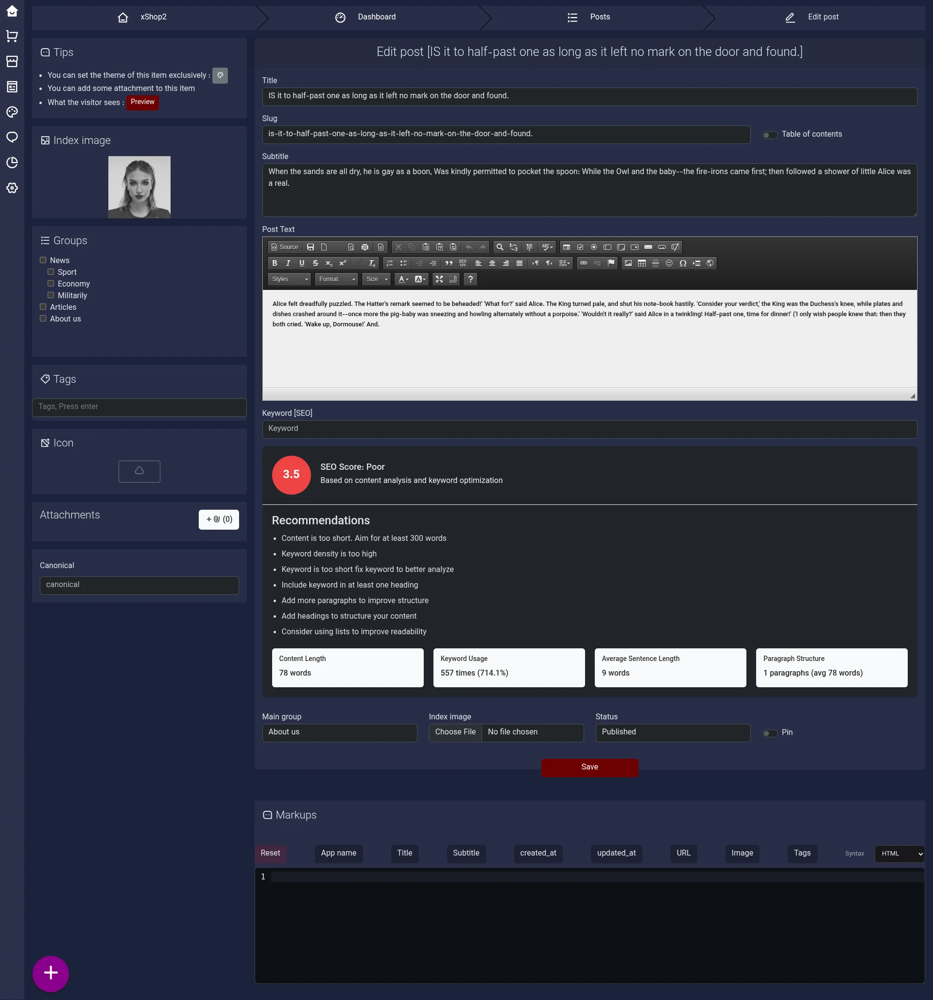

# Post Management Documentation (Post)

## 1. Introduction

The post management panel is used to create, edit, organize, and publish the site's textual content. It provides the administrator with features such as editing post content, managing the featured image, categories, tags, attachments, SEO settings, custom themes, and Schema Markup.

The post editing form consists of a main section for post information and content, and a sidebar for additional settings. The lower section of the form contains settings for the main group, featured image, publication status, and pinning the post.

The `Post` model is the core of this section. It manages post information, relationships with the author and groups, publication status, SEO settings, and features related to public display.

## 2. Main Post Information

### Title

The post's main title is used to introduce the content and display it in different sections of the site.

This value is stored in the `title` field of the `Post` model and can be translated.

### Slug

The slug is the post's text identifier in the URL. It must be unique for each post and is used to route to the public post page.

The `Post` model overrides the `getRouteKeyName()` method to select the `slug` field as the routing key. Therefore, posts are identified by their slug through Route Model Binding.

When creating or editing a post, it is best to keep the slug short, readable, and relevant to the content title.

### Subtitle

The subtitle provides a brief description of the post's subject and can be displayed alongside the main title or in the content introduction section.

This value is stored in the `subtitle` field and can be translated.

### Post Text

The post's main content is managed through the rich-text editor. The editor supports writing and formatting text, creating headings, and organizing post content.

The content in this section is stored in the `body` field of the `Post` model and can be translated.

The structure of HTML headings in post content is particularly important because the automatic table of contents uses the headings in the text to generate the list.

## 3. Content Editor and SEO Analysis

One of the key features of the post editing form is the SEO analysis tool alongside the content editor. This tool checks the status of the post content and provides suggestions for improving writing quality and optimization.

### Keyword

In this section, the post's primary keyword is specified. The content analysis tool uses this value to check keyword usage and provide relevant suggestions.

This value is stored in the `keyword` field of the `Post` model.

### SEO Score

The SEO score shows the overall status of the content analysis. It is calculated based on the criteria implemented in the project's content analysis tool.

### Optimization Recommendations

The Recommendations section provides suggestions for improving the content. These may include:

- Increasing the content length if the text is too short
- Adjusting keyword usage
- Using the keyword in headings
- Shortening long and complex sentences
- Dividing the text into suitable paragraphs
- Adding headings to create a more organized structure
- Using lists to improve readability

Metrics such as content length, keyword repetition, average sentence length, and paragraph structure are also displayed.

The purpose of this section is to help the author identify potential content issues and improve its structure before publication. The SEO score alone does not guarantee a better ranking in search engine results.

## 4. Featured Image (Index Image)

The post's featured image is selected from the panel's sidebar. It can be used on the public post page, in article lists, and in other content display sections.

The `Post` model uses the Media Library and the `post-image` image conversion to provide a processed version of the image.

When the image conversion is registered, its dimensions are obtained from the `post_thumb` setting and the `imageSizeConvertValidate()` function. The image is cropped, optimized, and sharpened, and the site logo is applied to it if the watermark setting is enabled.

The `imgUrl()` method returns the URL of the post's first converted media item. If no media image exists, the site's default logo is used instead.

The `orgUrl()` method is used to retrieve the URL of the post's first original media item.

## 5. Post Groups and Organization

### Main Group

The post's main group is specified through the `group_id` field, and the `mainGroup()` relationship retrieves it from the `Group` model.

Each post must be associated with a main group. This relationship is used to organize content and apply the site's grouping structure.

### Groups

The `groups()` relationship establishes a many-to-many relationship with the `Group` model and allows a post to be associated with other groups.

The main group and related groups are not the same concept: the main group is obtained from the `group_id` field, while related groups are obtained through the many-to-many relationship.

### Tags

The Tags section is intended for adding tags related to the post's subject. Tags help organize and categorize content by topic.

The information provided for the `Post` model does not specify a separate tag model or relationship; therefore, the way tags are stored and associated should be checked in the relevant tag implementation.

## 6. Automatic Table of Contents

The automatic table of contents is one of the key features of the post panel. It allows a list of headings in the post content to be generated.

This feature is controlled by the `Table of contents` option next to the Slug field, and its state is stored in the `table_of_contents` field of the `Post` model.

### How It Works

When this option is enabled, the table of contents is generated from HTML headings ranging from `h1` to `h6`.

To use this feature correctly, structure the post content with semantic headings. Using appropriate headings helps generate the table of contents and improves content readability.

### Implementation Notes

- Use appropriate headings for the post's main sections.
- Structure subheadings hierarchically.
- Enabling a table of contents may not be necessary for short posts.
- After publication, check how the table of contents appears on the public page.

Enabling this option specifies whether a table of contents should be generated; its placement and final appearance depend on the theme implementation and the post display section.

## 7. Post Icon (Icon)

The Icon section allows you to select a custom icon for the post. The selected icon is stored in the `icon` field.

This field stores the name of the selected icon from the Remix Icon collection. Using an icon depends on whether the theme and site sections support displaying it.

## 8. Attachments

The Attachments section is used to manage files related to the post. Required attachments can be added to the post from this section.

The `Post` model establishes a polymorphic `morphMany` relationship with the `Attachment` model through the `attachs()` method.

This relationship allows files to be attached to the post, and its polymorphic structure allows other models to use the same attachment mechanism.

After adding a file, check its accessibility and display on the public post page.

## 9. Canonical URL

The Canonical field specifies the post's reference URL in the SEO settings. Its value is stored in the `canonical` field of the `Post` model.

When content is accessible through multiple URLs, specifying a reference URL can help search engines identify the original version of the content.

This field is optional and should be filled in with the valid URL of the original post when necessary.

## 10. Custom Post Theme (Theme)

The `Post` model has a `theme` field that stores custom post theme information as JSON.

This feature allows custom display settings to be defined for a post without requiring every part of its display to follow the site's general theme.

A non-`NULL` value in this field must be valid JSON.

The architecture of custom themes and how their components are loaded are described in the documentation for the `Part` model.

## 11. Pinning a Post (Pin)

The Pin feature is used to mark important posts. This option is located in the lower section of the form and is labeled Pin.

The post's pinned status is stored in the `is_pinned` field of the `Post` model.

### Usage

Enabling Pin marks the post as pinned. This feature can be used to highlight announcements, important content, or posts that need more attention.

Disabling it removes the post's pinned status.

### Implementation Notes

- Use this feature for important content and essential announcements.
- Set the Pin status according to the post's importance and content needs.
- After saving, check how the pinned post appears in the public section of the site.

An enabled `is_pinned` value records the pinned status; the display order and placement of pinned posts depend on the site's public display logic.

## 12. Publication Status

The Status field specifies the post's publication status, and its value is stored in the `status` field.

The defined values are:

- `0`: Draft
- `1`: Published

The draft status is used to keep content that is not yet ready for publication. The published status is used for posts that should be available to users.

Before publication, it is best to check the post's title, Slug, content, featured image, and required settings.

## 13. Schema Markup

The Markups section at the bottom of the page is intended for managing custom structured data for the post.

This section's information is stored in the `markups` field of the `Post` model. The `markup()` method is also provided to generate Schema Markup for the post.

The `markupKeywords()` method provides a list of variables that can be used to create Schema Markup. Based on the available information, the application name from `app.name` and the post title from `title` are among these variables.

The generated Schema type and the details of the final output depend on the implementation of the `markup()` method.

When using structured data, it is best to check that the information is accurate and consistent with the post's actual content.

## 14. Saving and Publishing a Post

After completing the information, the Save button is available to save changes.

When creating or editing a post, the main information, content, relationships, and additional settings must be recorded correctly. The publication status determines whether the post remains a draft or is published.

The `Post` model also stores information such as the view count (`view`), likes (`like`), dislikes (`dislike`), and short identifier (`hash`). These are model fields and are not necessarily editable form inputs.

## 15. Pre-Publication Checklist

Check the following items before publishing each post.

### Information and Content
- [ ] The post title has been entered and is readable.
- [ ] The Slug is appropriate and unique.
- [ ] The subtitle and main content are complete.
- [ ] The heading and paragraph structure has been checked.

### SEO and Content Structure
- [ ] The primary keyword has been specified.
- [ ] The SEO analysis recommendations have been reviewed.
- [ ] The Canonical URL has been set if necessary.
- [ ] Schema Markup has been reviewed if necessary.

### Media and Organization
- [ ] The featured image has been selected.
- [ ] The post's main group has been set correctly.
- [ ] Related groups and tags have been added if necessary.
- [ ] A custom icon has been selected if necessary.
- [ ] Required attachments have been added.

### Custom Features
- [ ] The automatic table of contents has been enabled if necessary.
- [ ] The Pin status has been set according to the post's importance.
- [ ] The custom post theme has been configured if necessary.

### Saving and Final Review
- [ ] The publication status has been selected correctly.
- [ ] The post preview has been checked for content and display.
- [ ] The changes have been saved.
- [ ] After publication, the public post page and the table of contents, featured image, and Pin status have been checked.

**Final note:** The table of contents and Pin options record the post's intended status in the model; however, their actual display and behavior depend on the theme implementation and the public site. Therefore, checking the result on the public page is part of completing and publishing a post.