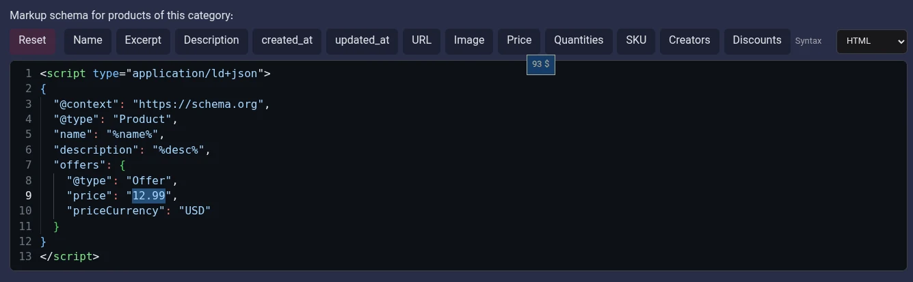

# Guide to Using the Schema Markup Editor

## Editor Introduction

The Schema Markup editor is used to define and edit structured data. You can use this editor to enter Schema code and, when needed, use replaceable variables to access information related to the content in question.

This editor can be used in different areas of the panel, such as products, posts, and users. **The buttons and variables available in each editor may differ depending on the type of information in that area.**



*Figure 1 - Example of the Schema Markup editor in the products section. The buttons shown in this image are specific to this example and are not necessarily the same in other areas of the panel.*

## Editor Components

### 1. Variable Insertion Buttons

The buttons above the editor are used to insert variables that let you use information related to the current content in the Schema code.

The available variables depend on the entity type and the information available for it. For example, the editor for products may have buttons for the name, price, and image, while the users section may provide variables such as email.

Therefore, check the list of buttons in the editor you are using, and use the variables available in that section.

### 2. Viewing Variable Hints

To view a variable's description or sample value, hover over its button. A short hint appears, showing information about that variable.

This hint helps you identify the variable's purpose before inserting it.

### 3. Inserting a Variable into the Code

To add a variable to the code, click its corresponding button. How the variable is inserted depends on the text selection in the editor:

- **If some text is selected,** the selected text is replaced with the corresponding variable.
- **If no text is selected,** the variable is inserted at the current cursor position.

For example, if you click the `Name` button in the editor for products, the variable for the name is inserted into the code. The exact form of the variable and its replacement value depend on that editor's settings.

### 4. Reset Button

The `Reset` button is used to restore the editor to its initial state.

If you have changed the editor's content and want to restore its initial state, you can use this button.

**Important:** Review the current content before using Reset; resetting may discard changes made in the editor.

### 5. Syntax Option

The `Syntax` option is used to select the code syntax for the editor. In the example image, the selected value is `HTML`.

Set this option to match the format of the code you enter.

### 6. Code Editing Area

The main editing area is used to enter, view, and edit Schema Markup code.

You can enter the code directly in this area or use the buttons above the editor to insert the required variables in the appropriate locations.

You can enter multiple schemas in one editor, so this area is not limited to a single schema.

## Example of Using Variables

The following example shows a `Product` schema with the name and description specified using replaceable variables:

```html
<script type="application/ld+json">
{
  "@context": "https://schema.org",
  "@type": "Product",
  "name": "%name%",
  "description": "%desc%",
  "offers": {
    "@type": "Offer",
    "price": "12.99",
    "priceCurrency": "USD"
  }
}
</script>
```

In this example:

- `%name%` is the variable for the name.
- `%desc%` is the variable for the description.
- The value `12.99` is entered as a fixed value.
- The value `USD` specifies the currency.

When displayed, the system replaces the variables. As a result, the defined variables are replaced with values related to the content in question.

**This example is intended only to explain how to use variables.** Select the Schema type, fields, and appropriate variables based on the entity and the information available in the relevant editor.

## Important Notes

- The list of buttons and variables is not the same in every Schema editor.
- To learn about a variable, hover over its button and review the displayed hint.
- If text is selected, clicking a variable button replaces the selected text; otherwise, the variable is inserted at the cursor position.
- You can enter multiple schemas in one editor.
- Check the editor's current content before using Reset.
- The code structure and entered values must be compatible with the Schema type and the information for the content in question.