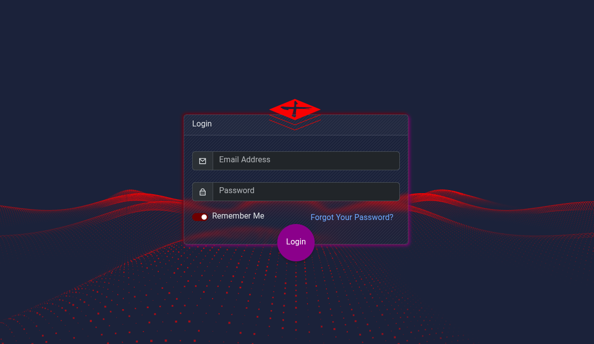

# ورود به سامانه 

روش پیش‌فرض ورود برای کاربران یا بهتر بگوییم مدیران روش پیشنهاد شده laravel و laravel-ui هست یعنی احراز هویت با email و password است.

ضمناً هیچ گزینه ثبت نام مستقیم برای سامانه فعال نمی‌باشد باید کاربران با seeder ساخته شوند یا یکی از مدیران کاربر جدید را ایجاد کنند.

اگر پسورد خود را پس از seed عوض نکردید اطلاعات پیشفرض ورود به این شکل است:

| Role      | Email                   | Password   |
|-----------|-------------------------| ---------- |
| Developer | `developer@example.com` | `password` |
| Admin     | `admin@example.com`     | `password` |
| User      | `user@example.com`      | `password` |

> Change the default password after logging in, especially if the application is accessible from the public internet.

صفحه ورود:

