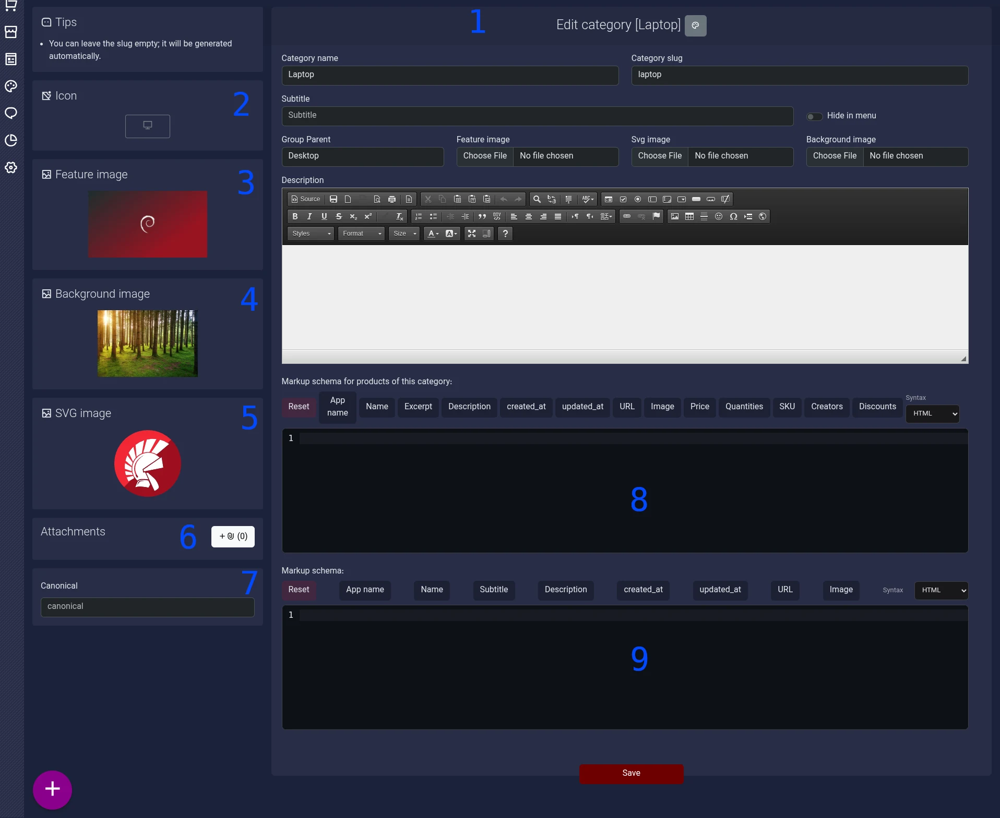

# راهنمای مدیریت دسته‌بندی‌ها

## معرفی صفحه

صفحه‌ی ویرایش دسته‌بندی برای مدیریت اطلاعات، محتوای متنی، تصاویر، جایگاه دسته‌بندی در ساختار سایت و تنظیمات مربوط به نمایش و سئوی آن استفاده می‌شود.

در این صفحه می‌توانید دسته‌بندی را معرفی کنید، آن را به یک دسته‌بندی والد متصل کنید، تصاویر موردنیاز قالب را مشخص کنید و در صورت نیاز، Schema Markup مربوط به صفحه‌ی دسته‌بندی یا محصولات زیرمجموعه‌ی آن را تنظیم کنید.

تصویر ۱ ـ نمای کلی صفحه‌ی ویرایش دسته‌بندی. شماره‌ها محل بخش‌های مختلف فرم را مشخص می‌کنند.



## ۱. ویرایش اطلاعات اصلی دسته‌بندی

این بخش اطلاعات اصلی دسته‌بندی و محتوای آن را مدیریت می‌کند.

| فیلد          | کاربرد                                                                                                                                            |
| ------------- | ------------------------------------------------------------------------------------------------------------------------------------------------- |
| Category name | نام دسته‌بندی را مشخص می‌کند.                                                                                                                     |
| Category slug | شناسه‌ی متنی مورد استفاده در آدرس صفحه‌ی دسته‌بندی است. طبق راهنمای پنل، اگر این فیلد خالی باشد، مقدار آن به‌صورت خودکار تولید می‌شود.            |
| Subtitle      | زیرعنوان دسته‌بندی را مشخص می‌کند.                                                                                                                |
| Group Parent  | دسته‌بندی والد را برای قرار دادن دسته‌بندی فعلی در ساختار سلسله‌مراتبی انتخاب می‌کند.                                                             |
| Hide in menu  | مشخص می‌کند دسته‌بندی در منوهایی که زیر‌دسته‌ها را نمایش می‌دهند، مخفی شود یا خیر. این گزینه به‌تنهایی به معنی غیرفعال شدن صفحه‌ی دسته‌بندی نیست. |
| Description   | توضیحات دسته‌بندی را ثبت می‌کند. این بخش از ویرایشگر متنی برای نگارش و قالب‌بندی محتوا استفاده می‌کند.                                            |

نام، زیرعنوان و توضیحات دسته‌بندی از محتوای چندزبانه پشتیبانی می‌کنند.

نکته: مخفی کردن دسته‌بندی از منو با غیرفعال کردن آن تفاوت دارد. این گزینه برای کنترل نمایش در منوهای مربوط به زیر‌دسته‌هاست.

> نکته مهم با کلیک روی دکمه طوسی کنار عنوان که پالت رنگ نقاشی است. می‌توانید برای این دسته یک قالب مجزا طراحی کنید. 

## ۲. انتخاب آیکون دسته‌بندی

در این قسمت می‌توانید آیکون دسته‌بندی را انتخاب کنید. آیکون انتخاب‌شده می‌تواند برای نمایش بصری دسته‌بندی در بخش‌هایی از سایت که از آیکون پشتیبانی می‌کنند، استفاده شود.

## ۳. تصویر شاخص (Feature image)

این بخش برای انتخاب تصویر اصلی دسته‌بندی است. تصویر انتخاب‌شده می‌تواند در فهرست‌ها یا بخش‌های مختلف سایت که برای نمایش دسته‌بندی از تصویر شاخص استفاده می‌کنند، نمایش داده شود.

برای انتخاب تصویر، از گزینه‌ی بارگذاری فایل در همین قسمت استفاده کنید.

## ۴. تصویر پس‌زمینه (Background image)

در این قسمت می‌توانید تصویر پس‌زمینه‌ی دسته‌بندی را مشخص کنید. این تصویر برای برخی حالت‌های قالب قابل استفاده است و ممکن است در طراحی بخش‌های مختلف سایت به کار رود.

استفاده از این تصویر به نحوه‌ی طراحی و تنظیمات قالب بستگی دارد.

## ۵. تصویر SVG

این بخش برای انتخاب تصویر با فرمت SVG است. تصویر SVG می‌تواند در برخی قالب‌ها، در کنار تصویر شاخص یا در بخش‌های طراحی‌شده‌ی مخصوص خود استفاده شود.

توجه: تصویر شاخص، تصویر پس‌زمینه و تصویر SVG کاربرد یکسانی ندارند. هرکدام را متناسب با نیاز قالب و محل نمایش موردنظر انتخاب کنید.

## ۶. پیوست‌های دسته‌بندی (Attachments)

این قسمت برای مدیریت پیوست‌های مرتبط با دسته‌بندی است.

دکمه‌ی افزودن پیوست، امکان شروع فرایند اضافه کردن پیوست را فراهم می‌کند. عدد کنار دکمه، تعداد پیوست‌های نمایش‌داده‌شده در این بخش را نشان می‌دهد.

جزئیات انواع پیوست‌های قابل افزودن و نحوه‌ی نمایش آن‌ها به رفتار مربوط به پیوست‌ها در پنل وابسته است.

## ۷. آدرس Canonical

فیلد Canonical برای ثبت آدرس مرجع صفحه‌ی دسته‌بندی در تنظیمات سئو استفاده می‌شود.

این آدرس به موتورهای جست‌وجو کمک می‌کند نسخه‌ی مرجع صفحه را تشخیص دهند؛ موضوعی که در مدیریت صفحات مشابه یا آدرس‌هایی با محتوای یکسان اهمیت دارد.

نکته: مقدار این فیلد را با دقت وارد کنید؛ آدرس Canonical باید با صفحه‌ای که قصد معرفی آن به‌عنوان نسخه‌ی مرجع را دارید، مطابقت داشته باشد.

## ۸. Schema Markup پیش‌فرض محصولات زیرمجموعه

این بخش برای تعریف Schema Markup مربوط به محصولات زیرمجموعه‌ی دسته‌بندی است؛ یعنی ساختار داده‌ای که برای محصولات مرتبط با این دسته‌بندی در نظر گرفته می‌شود.

Schema Markup نوعی داده‌ی ساختاریافته است که اطلاعات محتوا را با قالبی قابل‌فهم برای موتورهای جست‌وجو ارائه می‌کند. برای مثال، در یک اسکیما از نوع `Product` ممکن است نام محصول، توضیحات و قیمت آن مشخص شود.

### نحوه‌ی استفاده

محتوای Schema Markup را در ویرایشگر وارد کنید. می‌توانید یک اسکیما یا چند اسکیما را در این بخش قرار دهید؛ محدودیت به یک اسکیما وجود ندارد.

برای مثال، یک اسکیما می‌تواند به این شکل باشد:

```
<script type="application/ld+json">
{
  "@context": "https://schema.org",
  "@type": "Product",
  "name": "%name%",
  "description": "%desc%",
  "offers": {
    "@type": "Offer",
    "price": "%price%",
    "priceCurrency": "USD"
  }
}
</script>
```

در این مثال، `%name%`، `%desc%` و `%price%` متغیرهایی هستند که برای جایگزینی مقادیر مربوط به محصول استفاده شده‌اند. هنگام نمایش، سیستم جایگزینی متغیرها را انجام می‌دهد.

مثال بالا صرفاً نمونه‌ای از ساختار قابل‌استفاده است؛ صحت و تناسب فیلدها و مقادیر هر اسکیما باید با نوع محتوا و اطلاعات واقعی آن سازگار باشد.

### دکمه‌های درج متغیر

بالای ویرایشگر، دکمه‌هایی برای درج مقادیر قابل‌جایگزینی قرار دارند؛ مانند `Name`، `Description`، `Price` و سایر موارد نمایش‌داده‌شده در پنل.

1. برای مشاهده‌ی راهنمای هر متغیر، نشانگر ماوس را روی دکمه‌ی مربوطه نگه دارید. راهنما مقدار یا توضیح مرتبط با آن را نمایش می‌دهد.
2. اگر بخشی از متن داخل ویرایشگر را انتخاب کرده باشید، با کلیک روی دکمه‌ی متغیر، متن انتخاب‌شده با متغیر مربوطه جایگزین می‌شود.
3. اگر متنی انتخاب نشده باشد، متغیر در محل فعلی مکان‌نما (Cursor) درج می‌شود.

برای مثال، کلیک روی دکمه‌ی `Name` می‌تواند عبارت `%name%` را در محل موردنظر قرار دهد. این کار به شما کمک می‌کند به‌جای وارد کردن مستقیم یک مقدار ثابت، از متغیر مناسب استفاده کنید.

### انتخاب Syntax

در سمت راست دکمه‌های متغیر، گزینه‌ی `Syntax` قرار دارد. این گزینه برای انتخاب حالت نگارش کد در ویرایشگر استفاده می‌شود. در تصویر، مقدار انتخاب‌شده `HTML` است.

از آنجا که Schema Markup ممکن است در قالب‌های متفاوتی نوشته شود، قالب انتخابی را متناسب با محتوایی که وارد می‌کنید در نظر بگیرید.

## ۹. Schema Markup صفحه‌ی دسته‌بندی

این بخش برای تعریف Schema Markup مربوط به خود صفحه‌ی دسته‌بندی است، نه محصولات زیرمجموعه‌ی آن.

اگر می‌خواهید داده‌ی ساختاریافته‌ی صفحه‌ی دسته‌بندی را تعریف کنید، کد مربوطه را در این ویرایشگر قرار دهید. مانند بخش قبل، امکان وارد کردن چند اسکیما وجود دارد و این قسمت به یک اسکیما محدود نیست.

دکمه‌های بالای ویرایشگر نیز برای درج متغیرهای قابل‌جایگزینی در متن اسکیما استفاده می‌شوند. روش کار آن‌ها مشابه بخش ۸ است:

- با نگه‌داشتن نشانگر ماوس روی دکمه، راهنمای متغیر نمایش داده می‌شود.
- با انتخاب متن و کلیک روی دکمه، متن انتخاب‌شده جایگزین می‌شود.
- در صورت انتخاب نکردن متن، متغیر در محل مکان‌نما درج می‌شود.
- هنگام نمایش، سیستم جایگزینی متغیرها را انجام می‌دهد.

در این بخش، متغیرهای نمایش‌داده‌شده در تصویر شامل مواردی مانند `App name`، `Name`، `Subtitle`، `Description`، `URL` و `Image` هستند.

تفاوت دو بخش Schema Markup

| بخش                                                 | کاربرد                                                   |
| --------------------------------------------------- | -------------------------------------------------------- |
| Schema Markup پیش‌فرض محصولات زیرمجموعه (شماره‌ی ۸) | تعریف داده‌ی ساختاریافته برای محصولات مرتبط با دسته‌بندی |
| Schema Markup صفحه‌ی دسته‌بندی (شماره‌ی ۹)          | تعریف داده‌ی ساختاریافته برای خود صفحه‌ی دسته‌بندی       |

بنابراین، هنگام وارد کردن کد، ابتدا مشخص کنید که هدف شما تعریف اطلاعات محصولات زیرمجموعه است یا اطلاعات صفحه‌ی دسته‌بندی.

## ذخیره‌ی تغییرات

پس از تکمیل اطلاعات و تنظیم بخش‌های موردنیاز، از دکمه‌ی Save در پایین صفحه برای ثبت تغییرات استفاده کنید.

پیش از ذخیره، بهتر است نام و آدرس دسته‌بندی، دسته‌بندی والد، تصاویر و محتوای واردشده در بخش‌های Schema Markup را بررسی کنید تا اطلاعات با هدف موردنظر شما مطابقت داشته باشند.