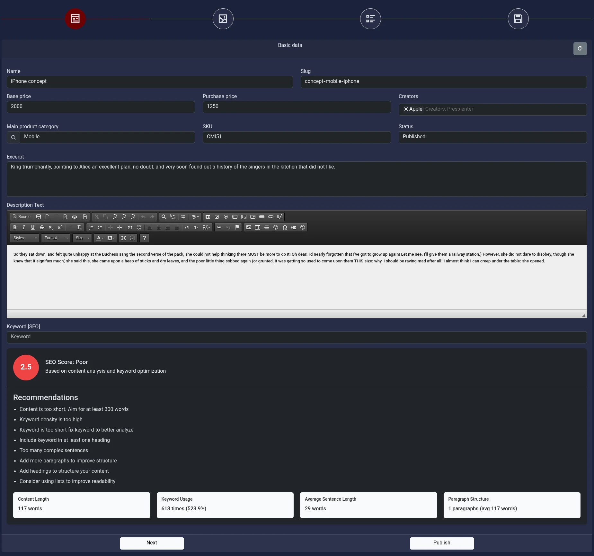
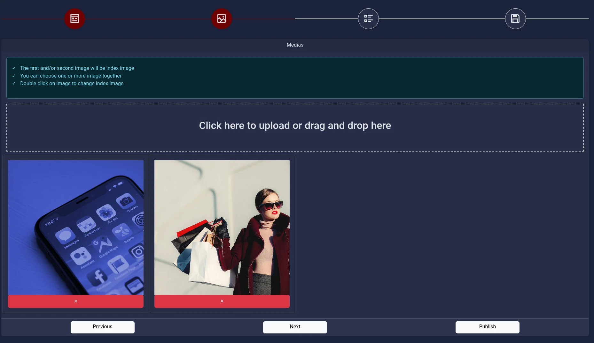
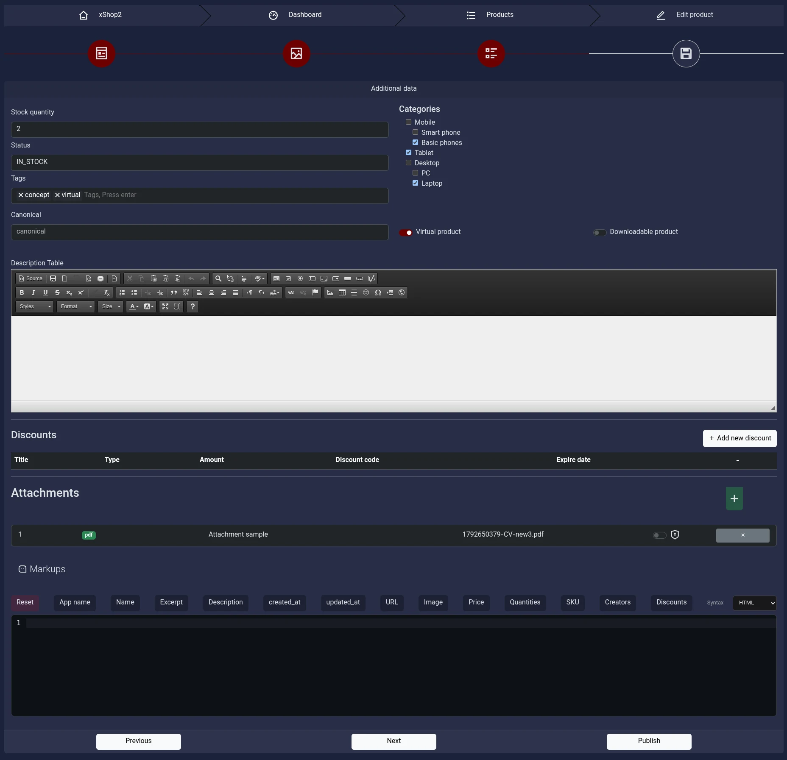
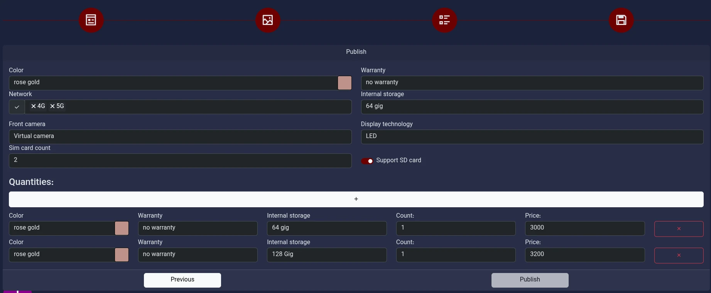

# مستند راهنمای مدیریت محصولات (Products)

این راهنما نحوه ایجاد و ویرایش محصول در پنل مدیریت را توضیح می‌دهد. فرم محصول به‌صورت یک Wizard چهارمرحله‌ای طراحی شده است تا اطلاعات پایه، تصاویر، مشخصات تکمیلی و موجودی محصول در بخش‌های مجزا مدیریت شوند.

در این فرم، بعضی اطلاعات به یکدیگر وابسته‌اند؛ برای مثال، تعداد موجودی محصول می‌تواند از گزینه‌های تعریف‌شده در بخش ویژگی‌ها و مقادیر (Properties Meta) محاسبه شود. همچنین فایل‌های پیوست می‌توانند به‌صورت عمومی یا ویژه خریداران محصول در دسترس قرار بگیرند.

## نمای کلی مراحل

مرحله ۱ — اطلاعات پایه (Basic Data)
نام و آدرس محصول، قیمت، دسته‌بندی اصلی، سازندگان، توضیحات، کلمه کلیدی سئو و تنظیم قالب اختصاصی محصول.

مرحله ۲ — رسانه‌ها (Medias)
بارگذاری تصاویر محصول، انتخاب تصویر شاخص و مدیریت تصاویر گالری.

مرحله ۳ — اطلاعات تکمیلی (Additional Data)
موجودی، وضعیت انتشار، برچسب‌ها، دسته‌بندی‌های دیگر، محصول مجازی یا دانلودی، جدول مشخصات، تخفیف‌ها، پیوست‌ها و Schema Markup.

مرحله ۴ — موجودی و گزینه‌ها (Quantities)
تعریف گزینه‌های مختلف محصول بر اساس ویژگی‌هایی مانند رنگ یا ظرفیت حافظه، همراه با تعداد و قیمت هر گزینه.

## مرحله ۱: اطلاعات پایه محصول (Basic Data)

مرجع تصویری: تصویر چهارم ارسالی — فرم Basic Data

در این مرحله اطلاعات اصلی محصول وارد می‌شود. این اطلاعات در صفحه محصول، جست‌وجو، دسته‌بندی‌ها و بخش‌های مرتبط با سئو مورد استفاده قرار می‌گیرند.

### فیلدهای اطلاعات پایه

| فیلد                  | توضیحات                                                                                                           |
| --------------------- | ----------------------------------------------------------------------------------------------------------------- |
| Name                  | نام محصول که به مشتری نمایش داده می‌شود.                                                                          |
| Slug                  | شناسه متنی مورد استفاده در URL محصول. در صورت پشتیبانی فرم، می‌توان آن را خالی گذاشت تا به‌صورت خودکار تولید شود. |
| Base price            | قیمت پایه محصول؛ در محصولاتی که گزینه‌های مقداری دارند، قیمت می‌تواند از گزینه‌ها محاسبه شود.                     |
| Purchase price        | قیمت خرید محصول که برای محاسبه حاشیه سود ناخالص استفاده می‌شود.                                                   |
| Creators              | سازندگان، برندها یا اشخاص مرتبط با محصول.                                                                         |
| Main product category | دسته‌بندی اصلی محصول.                                                                                             |
| SKU                   | شناسه انبارداری محصول؛ در صورت ثبت باید یکتا باشد.                                                                |
| Status                | وضعیت انتشار محصول؛ پیش‌نویس یا منتشرشده.                                                                         |
| Excerpt               | خلاصه کوتاه محصول برای نمایش در بخش‌های مختلف سایت و استفاده‌های مرتبط با SEO.                                    |
| Description Text      | توضیحات کامل محصول که با ویرایشگر متن غنی (Rich Text Editor) قابل ویرایش است.                                     |
| Keyword [SEO]         | کلمه کلیدی هدف برای تحلیل و بهینه‌سازی سئو.                                                                       |

### بررسی سئو (SEO Analysis)

ویرایشگر توضیحات محصول به قابلیت ارزیابی سئو مجهز است. پس از وارد کردن محتوا و کلمه کلیدی، سیستم می‌تواند امتیاز سئو، پیشنهادهای اصلاحی و شاخص‌هایی مانند طول محتوا، میزان استفاده از کلمه کلیدی، میانگین طول جمله و ساختار پاراگراف‌ها را نمایش دهد.

این ارزیابی به بهبود کیفیت محتوا کمک می‌کند؛ بااین‌حال، امتیاز نمایش‌داده‌شده به‌تنهایی تضمین‌کننده رتبه بهتر در موتورهای جست‌وجو نیست.

### تنظیم قالب اختصاصی محصول

دکمه طوسی دارای آیکون پالت رنگ در بالای فرم، امکان تنظیم قالب اختصاصی برای همان محصول را فراهم می‌کند.

- تنظیمات این بخش برای شخصی‌سازی نمایش محصول موردنظر است.
- تغییرات آن با تنظیمات قالب اختصاصی سایر محصولات یکسان نیست و به همان محصول مربوط می‌شود.
- از این قابلیت زمانی استفاده کنید که محصول موردنظر به نمایش متفاوتی نسبت به قالب عمومی سایت نیاز دارد.

## مرحله ۲: رسانه‌ها و تصاویر محصول (Medias)

مرجع تصویری: تصویر سوم ارسالی — فرم Medias

این مرحله برای بارگذاری و مدیریت تصاویر محصول طراحی شده است. تصاویر می‌توانند برای نمایش در گالری محصول و انتخاب تصویر شاخص استفاده شوند.

### بارگذاری تصاویر

برای افزودن تصویر، روی محدوده بارگذاری کلیک کنید یا فایل‌ها را به آن بکشید و رها کنید (Drag & Drop).

امکانات این بخش عبارت‌اند از:

- انتخاب یک یا چند تصویر: می‌توانید چند تصویر را هم‌زمان بارگذاری کنید.
- تصویر شاخص (Index Image): اولین و/یا دومین تصویر می‌تواند به‌عنوان تصویر شاخص در نظر گرفته شود.
- تغییر تصویر شاخص: طبق راهنمای نمایش‌داده‌شده در فرم، با دوبار کلیک روی تصویر می‌توانید آن را به تصویر شاخص تبدیل کنید.
- حذف تصویر: از دکمه حذف زیر تصویر مربوطه استفاده کنید.

نکته: بهتر است تصویر شاخص، نمای واضح و مناسبی از محصول داشته باشد؛ زیرا این تصویر ممکن است در فهرست محصولات، صفحه جزئیات محصول و بخش‌های دیگر سایت نمایش داده شود.

## مرحله ۳: اطلاعات تکمیلی (Additional Data)

مرجع تصویری: تصویر دوم ارسالی — فرم Additional Data

این مرحله شامل تنظیمات تکمیلی محصول، موجودی عمومی، دسته‌بندی‌ها، مشخصات، تخفیف‌ها، فایل‌های پیوست و اطلاعات ساختاریافته است.

### ۳.۱. موجودی و وضعیت محصول

| فیلد           | توضیحات                                                                                                                        |
| -------------- | ------------------------------------------------------------------------------------------------------------------------------ |
| Stock quantity | تعداد موجودی محصول. در صورت وجود گزینه‌های مقداری، این مقدار می‌تواند به‌صورت خودکار از مجموع موجودی گزینه‌ها به‌روزرسانی شود. |
| Status         | وضعیت موجودی محصول. مقادیر تعریف‌شده شامل `IN_STOCK`، `OUT_STOCK` و `BACK_ORDER` هستند.                                        |
| Tags           | برچسب‌های مرتبط با محصول برای دسته‌بندی موضوعی و کمک به جست‌وجو و بازیابی محتوا.                                               |

وضعیت موجودی با تعداد موجودی تفاوت دارد. برای مثال، محصولی ممکن است دارای وضعیت `IN_STOCK` باشد، اما برای در دسترس شناخته شدن، تعداد موجودی آن نیز باید بیشتر از صفر باشد.

اگر محصول دارای گزینه‌هایی مانند رنگ و ظرفیت حافظه است، موجودی هر گزینه را در مرحله چهارم تنظیم کنید. در این حالت، سیستم می‌تواند تعداد کل موجودی محصول را از مجموع موجودی گزینه‌ها محاسبه کند.

### ۳.۲. دسته‌بندی‌های محصول (Categories)

در این بخش می‌توانید محصول را به دسته‌بندی‌های دیگری نیز مرتبط کنید.

- دسته‌بندی اصلی در مرحله اول تعیین می‌شود.
- در این بخش امکان انتخاب دسته‌بندی‌های تکمیلی از ساختار درختی دسته‌بندی‌ها وجود دارد.
- انتخاب چند دسته‌بندی به معنای ارتباط محصول با چند بخش از سایت است؛ دسته‌بندی اصلی همچنان از فیلد اختصاصی خود مدیریت می‌شود.

### ۳.۳. آدرس Canonical

فیلد Canonical برای تعیین آدرس مرجع صفحه محصول در سئو استفاده می‌شود.

این فیلد زمانی کاربرد دارد که بخواهید موتورهای جست‌وجو یک URL مشخص را به‌عنوان نسخه اصلی محتوا در نظر بگیرند؛ برای مثال، زمانی که محتوای مشابه از چند آدرس قابل دسترسی است.

اگر به آدرس مرجع سفارشی نیاز ندارید، مقدار آن را بدون تغییر باقی بگذارید.

### ۳.۴. نوع محصول: مجازی و دانلودی

Virtual product — محصول مجازی

این گزینه برای محصولات یا خدماتی است که به ارسال فیزیکی نیاز ندارند. فعال‌کردن آن، محصول را به‌عنوان محصول مجازی مشخص می‌کند.

Downloadable product — محصول قابل دانلود

این گزینه برای محصولاتی است که خرید آن‌ها امکان دسترسی به فایل‌های قابل دانلود را فراهم می‌کند. برای نمونه، کتاب الکترونیکی، فایل آموزشی یا محتوای دیجیتال.

این دو گزینه کاربرد متفاوتی دارند و در صورت نیاز می‌توانند متناسب با نوع محصول تنظیم شوند.

### ۳.۵. جدول مشخصات (Description Table)

این بخش برای ثبت اطلاعات ساختاریافته محصول به‌صورت جدول استفاده می‌شود.

از آن برای نمایش مشخصات فنی یا اطلاعات تکمیلی محصول استفاده کنید؛ برای مثال، توضیحات مقایسه‌ای، اطلاعات مدل یا مشخصاتی که می‌خواهید به‌شکل جدولی در صفحه محصول نمایش داده شوند.

این بخش با ویرایشگر متن غنی مدیریت می‌شود؛ بنابراین می‌توانید محتوای جدول و قالب‌بندی آن را متناسب با نیاز محصول تنظیم کنید.

### ۳.۶. تخفیف‌ها (Discounts)

در بخش Discounts می‌توانید تخفیف‌های مرتبط با محصول را مدیریت کنید. با استفاده از دکمه Add new discount یک تخفیف جدید اضافه می‌شود.

| فیلد          | توضیحات                                                                      |
| ------------- | ---------------------------------------------------------------------------- |
| Title         | عنوان تخفیف برای شناسایی آن در پنل مدیریت.                                   |
| Type          | نوع تخفیف: `PRICE` برای مبلغ ثابت و `PERCENT` برای درصد تخفیف.               |
| Amount        | میزان تخفیف؛ در نوع مبلغ ثابت، مبلغ پولی و در نوع درصدی، عددی بین صفر تا صد. |
| Discount code | کد تخفیف؛ برای تخفیف‌های کددار قابل استفاده در سبد خرید.                     |
| Expire date   | تاریخ و زمان انقضای تخفیف. در صورت خالی بودن، تاریخ انقضایی تعریف نشده است.  |

تفاوت تخفیف مبلغی و درصدی:

- تخفیف مبلغی، مقدار مشخصی از قیمت کم می‌کند.
- تخفیف درصدی، درصدی از قیمت را کاهش می‌دهد.

در مدل سیستم، تخفیفی که به محصول مشخصی متصل باشد از طریق `product_id` به همان محصول ارتباط دارد. اگر این فیلد خالی باشد، تخفیف عمومی محسوب می‌شود و به محصول خاصی اختصاص ندارد.

### ۳.۷. پیوست‌های محصول (Attachments)

در بخش Attachments می‌توانید فایل‌های مرتبط با محصول را اضافه کنید؛ مانند دفترچه راهنما، فایل PDF، محتوای آموزشی یا فایل‌های دیجیتال.

افزودن پیوست

با استفاده از دکمه افزودن، فایل موردنظر را به محصول متصل کنید. فایل‌های پیوست می‌توانند علاوه بر عنوان و نام فایل، تنظیمات دسترسی نیز داشته باشند.

پیوست پریمیوم (Premium Attachment)

علامت سپر، وضعیت دسترسی ویژه پیوست را نشان می‌دهد. با فعال‌کردن سوئیچ کنار آن، پیوست به‌عنوان فایل پریمیوم تنظیم می‌شود.

رفتار دسترسی فایل‌ها به این صورت است:

- کاربر مهمان یا مشتری‌ای که محصول را نخریده است: فقط پیوست‌های غیرپریمیوم را دریافت می‌کند.
- مشتری واردشده‌ای که محصول را خریده است: می‌تواند به پیوست‌های غیرپریمیوم و پریمیوم دسترسی داشته باشد.

بنابراین، اگر فایلی باید فقط در اختیار خریداران محصول قرار بگیرد، آن را به‌عنوان پیوست پریمیوم تنظیم کنید.

### ۳.۸. Schema Markup محصول

در انتهای این مرحله، بخش Markups برای تنظیم Schema Markup محصول قرار دارد.

Schema Markup داده‌های ساختاریافته‌ای است که به موتورهای جست‌وجو کمک می‌کند نوع محتوا و اطلاعات آن را بهتر درک کنند. در این بخش می‌توانید قالب Markup متناسب با محصول را تعریف یا ویرایش کنید.

برای توضیحات مربوط به ویرایشگر، کلیدواژه‌های قابل استفاده، دکمه‌های درج خودکار مقادیر، انتخاب Syntax و عملکرد Reset، به مستندات ویرایشگر Schema Markup مراجعه کنید.

## مرحله ۴: موجودی و گزینه‌های مقداری (Quantities)

مرجع تصویری: تصویر اول ارسالی — فرم Quantities

این مرحله برای محصولاتی کاربرد دارد که در چند حالت یا ترکیب متفاوت عرضه می‌شوند؛ مانند رنگ‌های مختلف، ظرفیت‌های متفاوت یا ترکیب چند ویژگی.

برای مثال، یک گوشی ممکن است در رنگ Rose Gold و ظرفیت‌های ۶۴ و ۱۲۸ گیگابایت عرضه شود. هر ترکیب می‌تواند قیمت و موجودی مستقل داشته باشد.

### ۴.۱. تعریف گزینه‌های محصول

در هر ردیف، ویژگی‌های مربوط به یک گزینه محصول وارد می‌شوند.

| فیلد             | توضیحات                                                                          |
| ---------------- | -------------------------------------------------------------------------------- |
| Color            | رنگ گزینه محصول. ممکن است ورودی رنگی داشته باشد که انتخاب رنگ را ساده‌تر می‌کند. |
| Warranty         | وضعیت یا نوع گارانتی گزینه.                                                      |
| Internal storage | ظرفیت حافظه داخلی یا ویژگی مشابه، متناسب با مشخصات تعریف‌شده برای محصول.         |
| Count            | تعداد موجودی همین گزینه.                                                         |
| Price            | قیمت همین گزینه.                                                                 |

با استفاده از دکمه افزودن، گزینه جدیدی ایجاد می‌شود. هر ردیف معرف یک ترکیب مشخص از ویژگی‌هاست و می‌تواند تعداد و قیمت متفاوتی داشته باشد.

برای نمونه:

| رنگ       | حافظه  | تعداد | قیمت |
| --------- | ------ | ----- | ---- |
| Rose Gold | 64 GB  | 1     | 3000 |
| Rose Gold | 128 GB | 1     | 3200 |

در این مثال، مجموع موجودی گزینه‌ها برابر با ۲ واحد است.

### ۴.۲. ارتباط گزینه‌ها با موجودی محصول

موجودی تعریف‌شده در این مرحله با موجودی کلی محصول در ارتباط است.

طبق منطق مدل Product، متد `renewPriceAndStock()` در صورت وجود گزینه‌های مقداری:

- تعداد موجودی محصول را از مجموع `count` گزینه‌ها محاسبه می‌کند.
- قیمت پایه محصول را بر اساس کمترین قیمت گزینه‌هایی تعیین می‌کند که موجودی آن‌ها بیشتر از صفر است.

بنابراین، برای محصولات دارای گزینه، موجودی و قیمت هر ترکیب را در همین مرحله با دقت تنظیم کنید. مقدار موجودی کلی محصول می‌تواند به‌صورت خودکار از این اطلاعات به‌روزرسانی شود.

نکته: در پیاده‌سازی فعلی، محاسبه قیمت پایه به وجود حداقل یک گزینه با موجودی مثبت وابسته است. اگر هیچ گزینه‌ای موجودی نداشته باشد، رفتار قیمت باید با منطق فعلی سیستم بررسی شود.

### ۴.۳. ویژگی‌ها از کجا تعریف می‌شوند؟

گزینه‌های قابل انتخاب در این مرحله به ویژگی‌هایی وابسته‌اند که در بخش مدیریت ویژگی‌ها و Properties Meta تعریف شده‌اند.

به بیان ساده:

- ابتدا ویژگی‌هایی مانند رنگ، گارانتی یا ظرفیت حافظه تعریف می‌شوند.
- سپس این ویژگی‌ها برای محصول در دسترس قرار می‌گیرند.
- در مرحله چهارم، ترکیب‌های موردنظر ساخته می‌شوند و برای هر ترکیب تعداد و قیمت تعیین می‌شود.

اگر ویژگی موردنیاز در این مرحله وجود ندارد، ابتدا تعریف آن را در بخش مدیریت ویژگی‌ها بررسی کنید.
[مستندات ویژگی های متا](05-props.md)

## دکمه‌های پیمایش و انتشار

در پایین مراحل Wizard، دکمه‌های پیمایش و انتشار قرار دارند.

| دکمه     | کاربرد                                                    |
| -------- | --------------------------------------------------------- |
| Previous | بازگشت به مرحله قبلی برای بررسی یا اصلاح اطلاعات.         |
| Next     | رفتن به مرحله بعدی برای ادامه تکمیل فرم.                  |
| Publish  | ثبت نهایی و انتشار محصول مطابق وضعیت و منطق انتشار سیستم. |

پیش از انتشار نهایی، اطلاعات پایه، تصاویر، دسته‌بندی‌ها، قیمت‌ها، موجودی و پیوست‌های محصول را بررسی کنید. اگر محصول دارای فایل‌های پریمیوم است، حتماً وضعیت دسترسی آن‌ها را نیز کنترل کنید.

## چک‌لیست پیشنهادی پیش از انتشار

- نام محصول، Slug و دسته‌بندی اصلی تکمیل شده‌اند.
- قیمت پایه و قیمت خرید به‌درستی وارد شده‌اند.
- توضیحات محصول بررسی شده و پیشنهادهای مهم سئو در نظر گرفته شده‌اند.
- تصاویر محصول بارگذاری شده و تصویر شاخص مناسب انتخاب شده است.
- دسته‌بندی‌های تکمیلی و برچسب‌ها تنظیم شده‌اند.
- وضعیت موجودی با تعداد واقعی محصول هماهنگ است.
- در صورت وجود گزینه‌های مقداری، قیمت و تعداد هر گزینه بررسی شده‌اند.
- تخفیف‌ها و تاریخ انقضای آن‌ها کنترل شده‌اند.
- پیوست‌های پریمیوم و سطح دسترسی فایل‌ها بررسی شده‌اند.
- Canonical و Schema Markup در صورت نیاز تنظیم شده‌اند.

این چهار مرحله در کنار هم، فرایند کامل ایجاد و ویرایش محصول را پوشش می‌دهند؛ از تعریف اطلاعات اولیه و تصاویر تا تنظیم ویژگی‌ها، مدیریت موجودی و انتشار محصول در سایت.