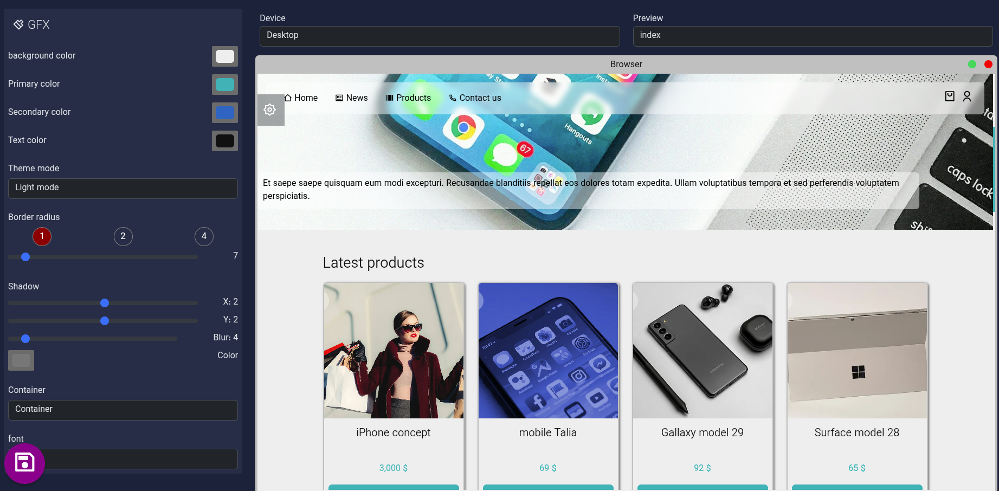

# GFX

این بخش برای تنظیم کردن نحوه نمایش کلی theme در سایت است الگویی که تقریبا تمامی theme part ها از آن باید تبعیت کنند.


::: warning
 شدیدا توصیه می‌شود تغییرات Theme بر روی نسخه local و غیر production اعمال شود.
::: 


توضیحات بخش های مختلف:

>تمامی تغییراتی که اعمال می‌کنید به صورت زنده قابل مشاهده است


- قسمت بالا پیش نمایش موبایل و دسکتاپ صفحاتی که پیش نمایش دارد
- Background color: رنگ زمینه را مشخص می‌کند 
- Primary color: رنگ اصلی وبسایت است
- Secondary color: رنگ مکمل رنگ اصلی است
- Text color: رنگ متن اصلی است
- Border radius: برای گرد بودن گوشه تقریبا تمامی المان های سایت است، که دارای سه قسمت است
  - ۱: برای گرد کردن ۴ جهت هزمان
  - ۲: برای گردن دو جهت قطری
  - ۳: برای تنظیم هر چهار گوشه است
-  Shadow: تنظیم سایه متداول المان ها است
- Container: برای مشخص کردن شیوه کانتینر به کار می‌رود کانتینر عریض (fluid) یا معمول
- بخش آخر تنظیم فونت است پیشفرض vazirmatin می‌باشد می‌توانید فونت دلخواه خود را اضافه کنید

> پس از پایان ویرایش حتما فراموش نکنید که تغییرات رو ذخیره کنید.

::: info
نکته بسیار مهم: اگر اعمال تغییرات با مشکل مواجه شد حتما باید theme را بسازید، دستورهای زیر ضروری است در این حالت:
::: 

```bash
php artisan client
pnpm run build # or npm
```

