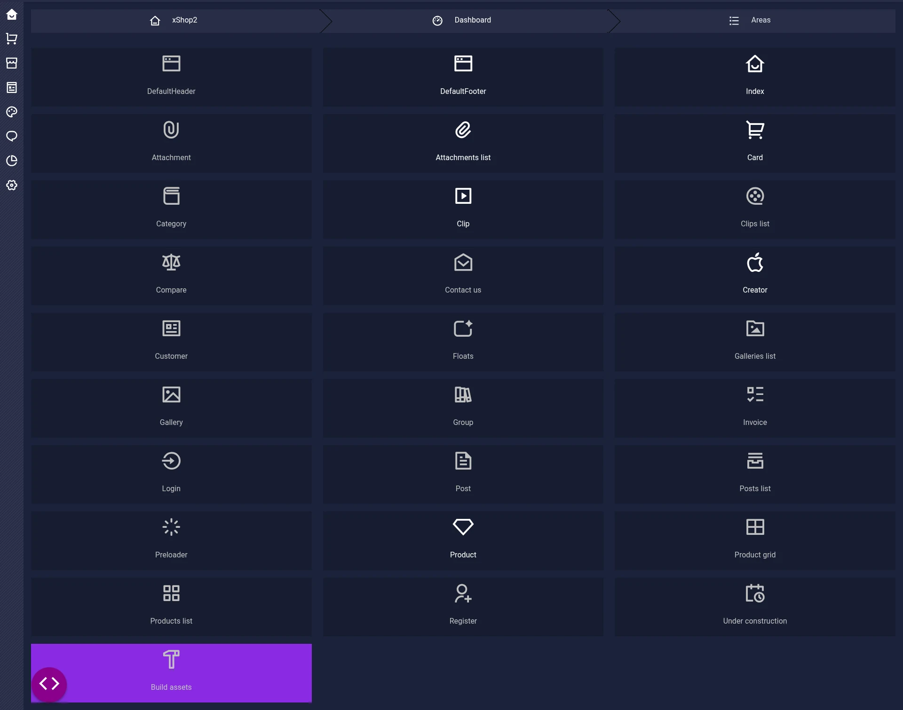
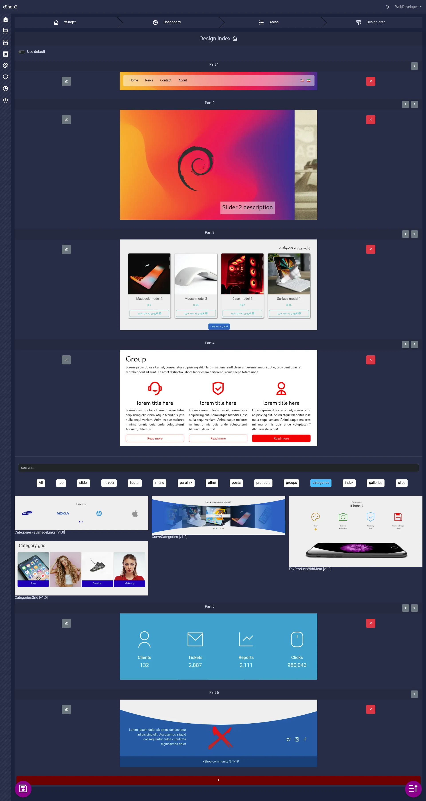

# Theme design

در این بخش می‌توانید به سادگی تمامی بخش‌های وبسایت را تغییر دهید و از تغییرات لذت ببرید.

::: warning
شدیدا توصیه می‌شود تغییرات Theme بر روی نسخه local و غیر production اعمال شود.
:::
با وجود توصیه بالا همچنان امکانات تغییرات در نسخه پروداکشن موجود است. می‌توانید از آن استفاده کنید.

##  انتخاب محیط Area



در این بخش تمامی بخش مورد نظر وجود دارد تا با توجه به آن محیط‌های مختلف را سفارشی سازی کنید.
فهرست محیط‌ها مشخص است.

### بخش های خاص:

- Default header: برای مشخص کردن هدر پیش فرض سایت است نه یک محیط کامل
- Default footer: برای مشخص کردن پا نوشت وبسایت پیش‌فرض سایت است نه یک محیط کامل
- Preloader: برای نمایش preloader در همه صفحات است
- Floats: برای بخش‌های شناور در همه صفحات است.
- Build assets: اجرا خودکار دستورات build theme است. که توصیه شده در نسخه production از آن استفاده نکنید.
- دکمه Rounded انتها با آیکون code فهرست Segment ها و بخش Theme را در یک محیط نمایش می‌دهد.
- سایر بخش ها مربوط به بخش های مختلف است

## ویرایش یک محیط


توضیحات ویرایش یک محیط:

- Use default: تعیین می‌کند آیا از header, footer پیش‌فرض استفاده شود یا خیر
- پایین تر تمامی بخش‌ها یعنی theme part وجود دارد قابلیت های زیر را دارد:
  - حذف
  - ویرایش یعنی تعویض با یک segment دیگر
  - جابه‌جایی ترتیب
- در انتها دکمه افزودن نیز وجود دارد

### ویرایش یا افزودن یک part 

زمانی که رو افزودن یا ویرایش می‌زنید لیستی از theme part های مجاز نمایش داده می‌شود

۱. شما می‌توانید با دیدن پیش‌نمایش آن را انتخاب کنید
۲. می‌توانید: از جستجو یا فیلتر استفاده کنید
۳. پس از انتخاب هر بخش در آخر دکمه save را بزنید.

### پس از ذخیره چه می‌شود

پس از ذخیره در تنظیمات بخش theme با توجه به نیاز‌های شما به روز خواهد شد. و می‌توانید تنظیمات مربوط به بخش‌های theme را به روز کنید.

و باید بعد پایان تمامی ویرایش ها برای اعمال تغییرات نهایی دکمه Build Assets را بزنید یا دستورات زیر را اجرا کنید:

```bash
php artisan client
pnpm run build # or npm
```
